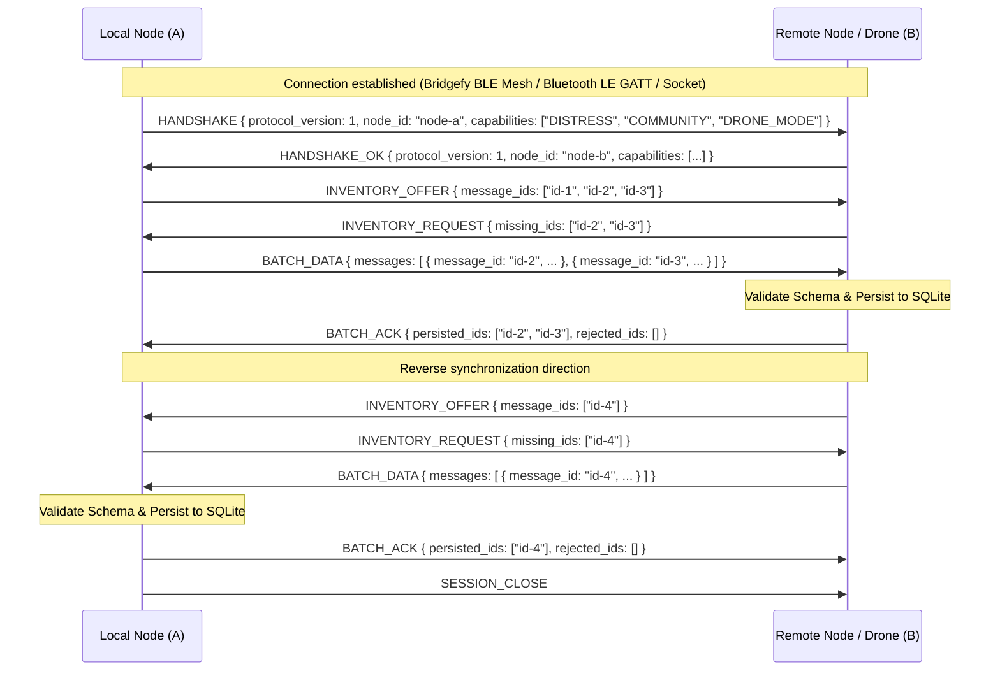

# Airborne Mesh: Synchronization Protocol Specification (v1)

## 1. Overview
The Airborne Mesh synchronization protocol provides deterministic, opportunistic store-and-forward exchange of emergency reports and rescue directives between offline Android nodes and rescue/drone endpoints.

## 2. Core Tenets
1. **Offline Independence:** Operates completely without internet infrastructure.
2. **Persistence Before ACK:** A receiver node **must** commit an incoming message to its local SQLite database before returning an acknowledgement payload.
3. **Idempotence & Deduplication:** All messages are keyed by `message_id` (UUIDv4). Multiple deliveries of the same `message_id` are no-ops.
4. **Evidence Preservation:** Conflicting reports (e.g. contradictory hazard or road conditions) are retained as distinct evidence records, preserving provenance and observation timestamps.

## 3. Session State Machine



## 4. Frame Types (JSON Encapsulated)

Every message over the transport socket is framed as a single JSON object terminated by a newline (`\n`):

### 4.1 Handshake
```json
{
  "type": "HANDSHAKE",
  "protocol_version": 1,
  "node_id": "urn:uuid:3f84877e-2cf8-410a-b328-8686e066a3d6",
  "role": "COMMUNITY_NODE",
  "timestamp": 1791633600
}
```

### 4.2 Inventory Offer
```json
{
  "type": "INVENTORY_OFFER",
  "items": [
    { "message_id": "d04a625f-f608-4681-bcfa-19c2c8f8b056", "created_at": 1791633600, "expires_at": 1791640800 }
  ]
}
```

### 4.3 Inventory Request
```json
{
  "type": "INVENTORY_REQUEST",
  "requested_message_ids": ["d04a625f-f608-4681-bcfa-19c2c8f8b056"]
}
```

### 4.4 Batch Data
```json
{
  "type": "BATCH_DATA",
  "messages": [
    {
      "schema_version": 1,
      "message_id": "d04a625f-f608-4681-bcfa-19c2c8f8b056",
      "original_sender": "device-alpha",
      "created_at": 1791633600,
      "expires_at": 1791640800,
      "message_type": "DISTRESS",
      "status": "CRITICAL",
      "body": "Trapped on roof, 3 adults 1 infant",
      "emergency_details": {
        "emergency_type": "FLOOD",
        "people_count": 4
      },
      "location": {
        "lat": 10.1234,
        "lng": 76.4567,
        "accuracy_m": 8.5,
        "observed_at": 1791633600
      },
      "hop_trail": []
    }
  ]
}
```

### 4.5 Batch Acknowledgement
```json
{
  "type": "BATCH_ACK",
  "persisted_ids": ["d04a625f-f608-4681-bcfa-19c2c8f8b056"],
  "failed_ids": []
}
```

## 5. Limits & Security Bounds
- Max payload per JSON frame: 1 MB.
- Max messages per batch: 50.
- Max hop trail length: 10 hops (bounded to prevent unbounded payload growth).
- Max body length: 1,024 characters.
- Expired messages: Excluded from active forward inventory once `current_time > expires_at`.
